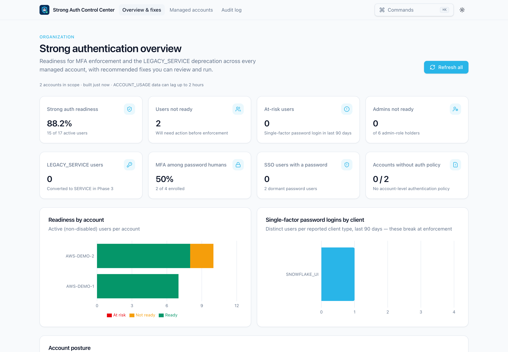

# Strong Auth Control Center

**One place to see and fix Snowflake strong-authentication readiness across all of your accounts.**

Snowflake is retiring single-factor passwords. Human users who sign in with a password must use MFA, and `LEGACY_SERVICE` users lose password access. Each account's [Strong Authentication Hub](https://docs.snowflake.com/en/user-guide/strong-authentication-hub) only shows that one account. This app signs in to every account you add and builds a single org-wide view. It recommends a concrete fix for every user who isn't ready, and lets you review and run those fixes with an audit trail.



---

## Contents

- [What it does](#what-it-does)
- [Fixes it can run, and what it doesn't do](#fixes-it-can-run-and-what-it-doesnt-do)
- [Quick start](#quick-start)
- [Using the app](#using-the-app)
- [Sign-in methods](#sign-in-methods)
- [Per-account setup](#per-account-setup)
- [How readiness is determined](#how-readiness-is-determined)
- [Safety model](#safety-model)
- [Configuration and data](#configuration-and-data)
- [Troubleshooting](#troubleshooting)
- [Development](#development)

---

## What it does

| Area | Capabilities |
|---|---|
| **Managed accounts** | Add, edit, remove, or bulk-import accounts by URL. Sign in to each in the browser with Snowflake OAuth or SSO, or use a PAT or key-pair file for unattended use. A per-account switch puts an account in or out of scope. Only accounts that are enabled and authenticated are ever queried or changed. |
| **Org-wide overview** | Readiness %, users not ready, at-risk users, admins not ready, `LEGACY_SERVICE` users, MFA coverage among password users, SSO users still holding a password, and accounts with no account-level authentication policy. |
| **Charts** | Readiness by account (ready / not ready / at risk), and single-factor password logins by client type: the tools that break at enforcement. |
| **Account posture** | Per account: users, readiness, at risk, legacy service users, admins not ready, account authentication policy (including its MFA enrollment setting), network policy, SSO integrations, and last collection time, with a per-account refresh. |
| **Recommended fixes** | One recommendation per issue, with severity, filters (account, severity, issue type, search), and **Review & run**. Each fix shows the reason, the impact, user facts, manual steps, and the exact SQL generated on the server. Execution requires explicit confirmation. Bulk runs require typing `EXECUTE`. |
| **Enforcement timeline** | Phase 1–3 windows from the [deprecation plan](https://docs.snowflake.com/en/user-guide/security-mfa-rollout), with pointers to where per-account dates and extensions are managed. |
| **Audit log** | Every executed statement, its result, the account, the user, and the time. |

---

## Fixes it can run, and what it doesn't do

### Fixes it can run

Every fix shows the reason, the impact, and the exact SQL before anything executes. A single fix needs the confirm checkbox. A bulk run needs you to type `EXECUTE`. The server only runs fixes that exist in the latest snapshot and builds the SQL itself.

| # | Issue it detects | Fix | SQL it runs | Notes |
|---|---|---|---|---|
| 1 | Human user with a password, no MFA, and password-only logins in the last 90 days (**at risk**) | Enroll in MFA | `CREATE AUTHENTICATION POLICY IF NOT EXISTS …` with `MFA_ENROLLMENT = 'REQUIRED_PASSWORD_ONLY'`, then `ALTER USER … SET AUTHENTICATION POLICY` | Needs a policy schema you supply. The user still has to enroll in Snowsight. BI tools that store this password may break. |
| 2 | SSO user who still has a password | Remove the unused password | `ALTER USER … UNSET PASSWORD` | |
| 3 | Human user with a password, no MFA, and no login in 90 days | Disable the user | `ALTER USER … SET DISABLED = TRUE` | Reversible with `SET DISABLED = FALSE`. |
| 4 | Integration typed as `PERSON` (detected by name or client pattern) with no strong credential | Register a key pair | `ALTER USER … SET RSA_PUBLIC_KEY = '…'` | You paste the public key. Private keys are rejected. Non-breaking. |
| 5 | Same as #4, but a key pair, PAT, or workload identity already exists | Remove password and convert to service | `ALTER USER … UNSET PASSWORD`, then `ALTER USER … SET TYPE = SERVICE` | Flagged **breaking** if password logins were seen recently. |
| 6 | `LEGACY_SERVICE` user using a password | Register a key pair, then remove password and convert | Same SQL as #4, then #5 | Two staged steps. The second is offered once a strong credential exists. |
| 7 | `LEGACY_SERVICE` user with an idle password | Disable the unused user (alternative to converting) | `ALTER USER … SET DISABLED = TRUE` | Any job still using this user will fail. |
| 8 | `LEGACY_SERVICE` user with no password | Convert to service | `ALTER USER … SET TYPE = SERVICE` | Cleanup only. These users already count as ready. |
| 9 | Account has no authentication policy | Set an account-level policy requiring MFA for password users | `CREATE AUTHENTICATION POLICY IF NOT EXISTS …`, then `ALTER ACCOUNT SET AUTHENTICATION POLICY` | Flagged **high impact**: applies to every user without their own policy. Needs a policy schema you supply. |

Fixes for users who hold `ACCOUNTADMIN`, `SECURITYADMIN`, `ORGADMIN`, `GLOBALORGADMIN`, or `USERADMIN` directly are raised to **critical** severity.

### Recommended but never run by the app

- **No account-level network policy:** guidance only. The app never creates or changes network policies.
- **Manual steps inside the fixes above:** asking users to enroll in MFA, generating key pairs, and switching connectors (Fivetran, Power BI, and so on) to key pair, PAT, or SSO. The app can register the public key, but it can't reconfigure the tool.

### What it does **not** do

- **Extend enforcement dates.** Extensions are requested in each account's Strong Auth Hub. The app only shows the timeline.
- **Undo a fix.** There is no undo button. The impact text gives the reversal SQL, such as `SET DISABLED = FALSE`, and you run it yourself.
- **Generate keys or handle private keys.** You create the key pair. The app only accepts the public key.
- **Detect indirect admin access.** Only roles granted directly to a user escalate severity. Users who reach `ACCOUNTADMIN` through other roles aren't escalated.
- **Match the Strong Authentication Hub exactly.** The app reads `SHOW USERS` and `ACCOUNT_USAGE`, not Trust Center findings, and `ACCOUNT_USAGE` lags up to about 2 hours. Counts can differ from the Hub. The readiness logic has been tested on demo accounts only, so compare against the Hub on a non-production account before relying on it.
- **Keep you signed in across restarts.** Sessions are in memory only, so restarting signs out of every account.
- **Touch accounts you haven't added.** Disabled and signed-out accounts are never queried or changed.

---

## Quick start

### Prerequisites

- **Node.js 20+** and npm (`nvm use` picks up `.nvmrc`)
- A desktop browser on the same machine. Sign-in opens there.
- For each Snowflake account: a user with a role that can read `SNOWFLAKE.ACCOUNT_USAGE` (see [Per-account setup](#per-account-setup))

### Install and run

```bash
git clone https://github.com/sfc-gh-ngerald/strong-auth-org-management.git
cd strong-auth-org-management
npm install
npm run dev
```

Open **http://127.0.0.1:3000**. There's nothing else to set up: no env file, no folders to create, no Snowflake objects required. The `config/` folder ships with the repo, and your account list and audit log are written there (git-ignored) the first time you add an account.

The app binds to `127.0.0.1` only. It's a local tool: browser sign-in completes on a loopback port, and the app connects out to each account directly. Don't deploy it to a shared server.

To use a production build instead of the dev server:

```bash
npm run build
npm start          # also binds to 127.0.0.1:3000
```

### First run in 60 seconds

1. Go to **Managed accounts** and click **Add account**.
2. Paste the account URL, for example `https://myorg-myaccount.snowflakecomputing.com`. Leave **Auth method** on *Snowflake OAuth*. Set **Role** (for example `ACCOUNTADMIN`). Leave **Warehouse** blank to use your default warehouse.
3. Click **Add account**. Your browser opens the account's login page; sign in (password + MFA, or SSO).
4. Repeat for each account you manage, then open **Overview & fixes**. The page fills in on its own, with no refresh needed.

---

## Using the app

### 1. Managed accounts: define your scope

Register every account you manage. Each row shows the auth method, the sign-in status or credential-file check, the role and warehouse, and connection results.

- **Sign in / Sign out:** for OAuth and SSO accounts. Signing in brings the account into scope, and signing out removes it.
- **Scope switch:** turns an account off without deleting it.
- **Test:** confirms the account, organization, role, and warehouse, and checks that `ACCOUNT_USAGE` is readable.
- **Import JSON:** adds many accounts at once. Every row is validated before anything is saved, and duplicates (same URL + user) are skipped.

```json
[
  {
    "label": "EDW Prod",
    "accountUrl": "https://myorg-edw_prod.snowflakecomputing.com",
    "authType": "OAUTH",
    "role": "ACCOUNTADMIN",
    "policySchema": "SECURITY_DB.POLICIES"
  },
  {
    "label": "EDW Dev",
    "accountUrl": "https://myorg-edw_dev.snowflakecomputing.com",
    "user": "STRONG_AUTH_ADMIN_SVC",
    "authType": "KEYPAIR",
    "credentialPath": "~/.snowflake/keys/strong_auth_admin.p8",
    "role": "STRONG_AUTH_ADMIN",
    "warehouse": "ADMIN_WH"
  }
]
```

| Field | Required | Notes |
|---|---|---|
| `accountUrl` | yes | Must be `https://*.snowflakecomputing.com` |
| `authType` | yes | `OAUTH`, `SSO`, `PAT`, or `KEYPAIR` |
| `role` | yes | Used for reads and for executing fixes |
| `label` | no | Defaults to the account locator |
| `user` | PAT / KEYPAIR only | For OAuth / SSO it's optional; if set, a sign-in as anyone else is rejected |
| `credentialPath` | PAT / KEYPAIR only | Path to the token file or PKCS#8 private key. `~` is expanded |
| `passphraseEnvVar` | no | KEYPAIR only: the *name* of an env var holding the key passphrase |
| `warehouse` | no | Blank uses the signed-in user's `DEFAULT_WAREHOUSE` |
| `policySchema` | no | Existing `DATABASE.SCHEMA` where fixes create authentication policies |
| `enabled` | no | Defaults to `true` |

### 2. Overview & fixes: see the whole org

The overview collects from every in-scope account in parallel. It refreshes automatically when you open it and when an account newly comes into scope. It also polls while any enabled account is still waiting for sign-in. **Refresh all** re-collects everything, and the icon on each account row refreshes just that account.

<!-- Add docs/screenshots/posture-and-fixes.png, then uncomment:

-->

Enabled accounts that are signed out are listed with a **Sign in** link. They're left out of every number until you sign in.

**User data source.** The toggle next to **Refresh all** picks where user attributes come from. Your choice is remembered:

| Mode | User attributes from | Best for |
|---|---|---|
| **Live users** *(default)* | `SHOW USERS`, in real time | Demos and remediation: new users and applied fixes show up on the next refresh |
| **ACCOUNT_USAGE** | `ACCOUNT_USAGE.USERS` (can lag up to ~2 h) | Matching what the Strong Auth Hub and ACCOUNT_USAGE reports show |

Login history, admin grants, and policy references always come from `ACCOUNT_USAGE`. Live mode falls back to `ACCOUNT_USAGE` if `SHOW USERS` fails. It also warns when `SHOW USERS` returns far fewer users than `ACCOUNT_USAGE`, because `SHOW USERS` only lists users the role can see.

### 3. Review and run a fix

Click **Review & run** on any recommendation. The side panel shows:

- **Why:** the specific evidence (for example, "has a password, no MFA, and no successful login in the last 90 days").
- **Impact:** what changes and how to undo it. Breaking or high-impact changes are flagged in red.
- **User:** type, email, password / MFA / key pair / PAT / workload identity, admin roles, and 90-day login breakdown by factor and client.
- **Manual steps:** anything SQL can't do, such as asking a user to enroll in MFA or switching a connector to key pair.
- **SQL to execute:** generated by the server from the latest snapshot. Some fixes need input (for example an RSA public key or a policy schema), and the SQL regenerates as you type.

Tick **I reviewed this SQL…** and click **Execute**. Statements run in order and stop at the first failure, and the result of each statement is shown and written to the audit log.

<!-- Add docs/screenshots/fix-review.png, then uncomment:

-->

**Bulk runs:** tick several fixes that need no input, click **Run selected**, and type `EXECUTE` to confirm.

**After a fix runs:** `ACCOUNT_USAGE` can take up to 2 hours to reflect the change. Until then the fix is marked *applied* and hidden by default. Untick *Hide fixes applied in the last 3 hours* to see it.

### 4. Audit log

**Audit log** lists every execution with its timestamp, account, user, fix, and each statement with its result. It is stored locally in `config/audit-log.jsonl`.

---

## Sign-in methods

| Method | How it works | Stored on disk | Best for |
|---|---|---|---|
| **Snowflake OAuth** *(default)* | **Sign in** opens the account's login page (password + MFA, or SSO). It uses Snowflake OAuth for local applications through the built-in `SNOWFLAKE$LOCAL_APPLICATION` integration (authorization code + PKCE, `127.0.0.1` redirect). Nothing needs configuring in the account. | **Nothing** | Interactive admin work |
| **SSO** | **Sign in** opens your identity provider (`EXTERNALBROWSER`). Requires SAML SSO on the account. | **Nothing** | Accounts that use SSO |
| **Key pair** | Reads a PKCS#8 private key from the path you give, with an optional passphrase from an env var. | Your key file | Unattended use |
| **PAT** | Reads a programmatic access token from a file that contains only the token. | Your token file | Unattended use (PAT users need a network policy by default) |

Browser sessions are held only in the app's memory, and the driver's credential cache is off. **Restarting the app signs every account out.** That's intentional: no refresh token sits on disk. Code reloads during development don't sign you out.

If your account blocks privileged roles for OAuth (`OAUTH_ADD_PRIVILEGED_ROLES_TO_BLOCKED_LIST`) and a sign-in as `ACCOUNTADMIN` is refused, the error says so. In that case use SSO, or a custom admin role such as `STRONG_AUTH_ADMIN` (below).

---

## Per-account setup

`ACCOUNTADMIN` works out of the box. For least privilege, create a dedicated role once per account (the same SQL is on the Managed accounts page under **Copy SQL**):

```sql
CREATE ROLE IF NOT EXISTS STRONG_AUTH_ADMIN;
GRANT IMPORTED PRIVILEGES ON DATABASE SNOWFLAKE TO ROLE STRONG_AUTH_ADMIN;      -- ACCOUNT_USAGE views
GRANT APPLICATION ROLE SNOWFLAKE.TRUST_CENTER_VIEWER TO ROLE STRONG_AUTH_ADMIN; -- Strong Auth Hub in Snowsight
GRANT USAGE ON WAREHOUSE ADMIN_WH TO ROLE STRONG_AUTH_ADMIN;                   -- or rely on users' default warehouse
GRANT ROLE SECURITYADMIN TO ROLE STRONG_AUTH_ADMIN;                            -- only if this app will execute fixes

-- Interactive use: grant the role to yourself and pick it as the account's role.
GRANT ROLE STRONG_AUTH_ADMIN TO USER <your_user>;

-- Unattended use: a dedicated service user with a key pair.
CREATE USER IF NOT EXISTS STRONG_AUTH_ADMIN_SVC TYPE = SERVICE
  DEFAULT_ROLE = STRONG_AUTH_ADMIN DEFAULT_WAREHOUSE = ADMIN_WH
  RSA_PUBLIC_KEY = '<public key body>';
GRANT ROLE STRONG_AUTH_ADMIN TO USER STRONG_AUTH_ADMIN_SVC;
```

| Capability | Needs |
|---|---|
| View metrics | `IMPORTED PRIVILEGES` on `SNOWFLAKE`, plus a warehouse (configured or the user's default) |
| Disable users, unset passwords, change `TYPE`, set RSA keys | Ownership of the users, or `SECURITYADMIN` |
| Create and apply authentication policies | `CREATE AUTHENTICATION POLICY` on the policy schema, and the right to apply it to users or the account (`SECURITYADMIN` / `ACCOUNTADMIN`) |
| Extend enforcement dates | Done in each account's Strong Auth Hub (requires `MODIFY` on the account). Not done from this app. |

---

## How readiness is determined

The app follows the Strong Authentication Hub's categories, using `SNOWFLAKE.ACCOUNT_USAGE` (which lags up to about 2 hours):

| Source | Used for |
|---|---|
| `USERS` | Type, password, MFA (incl. Duo), key pair, PAT, workload identity, disabled, last login |
| `LOGIN_HISTORY` (90 days) | Password-only vs MFA / SSO / key pair / PAT logins, reported client type, failed logins |
| `GRANTS_TO_USERS` | Direct holders of `ACCOUNTADMIN`, `SECURITYADMIN`, `ORGADMIN`, `GLOBALORGADMIN`, `USERADMIN` |
| `POLICY_REFERENCES` + `DESCRIBE AUTHENTICATION POLICY` | Account- and user-level authentication policies and the account policy's MFA enrollment setting |
| `SHOW PARAMETERS`, `SHOW SECURITY INTEGRATIONS` | Account network policy; SAML / OAuth integrations |

| User | Ready when | Issue → recommended fix |
|---|---|---|
| Human (`PERSON` / unset) | No password, or enrolled in MFA | **Password-only logins:** enroll in MFA (optionally attach a `MFA_ENROLLMENT = 'REQUIRED_PASSWORD_ONLY'` policy). **SSO user with a password:** `UNSET PASSWORD`. **Dormant (no login in 90 days):** `SET DISABLED = TRUE` |
| Integration typed as `PERSON` | n/a | Detected by name or client pattern. First register a key pair; once the tool uses it, `UNSET PASSWORD` and set `TYPE = SERVICE` |
| `LEGACY_SERVICE` | No password | **Using a password:** register a key pair, then convert. **Idle password:** convert, or disable if unused. **No password:** `SET TYPE = SERVICE` |
| `SERVICE` | Always | none |
| Account | n/a | **No account auth policy:** create and set one (flagged high impact). **No network policy:** guidance only, never applied automatically |

- **At risk:** the user isn't ready *and* signed in with a single-factor password in the last 90 days. That login will break at enforcement.
- **Admin escalation:** fixes for direct admin-role holders are escalated to **critical**.
- **Service migration is staged:** registering a key never breaks anything. Removing the password is a separate step, offered once a strong credential exists, and it carries a *breaking* warning if password logins are still being seen.

---

## Safety model

- **Local only:** the server binds to `127.0.0.1`. `proxy.ts` rejects requests whose `Host` isn't loopback, which blocks LAN access and DNS rebinding. It also rejects state-changing API calls that are cross-origin, cross-site, or not JSON, which blocks CSRF from other web pages.
- **The browser never sends SQL:** it sends a fix key and parameters. The server checks the fix exists in the latest snapshot and rebuilds the SQL itself. Identifiers are always double-quoted, and schema names and public keys are validated; private keys are rejected.
- **Nothing runs unconfirmed:** single fixes need a reviewed-SQL checkbox, and bulk runs need you to type `EXECUTE`. Every execution is audited.
- **No stored secrets:** OAuth and SSO sessions live in memory only. PAT and key-pair files are read from disk when connecting and never copied. `config/accounts.json` holds paths and metadata only.
- **Out of scope means untouched:** accounts that are disabled or signed out are never queried, and fixes can't run against them.

---

## Configuration and data

| What | Where |
|---|---|
| Account registry | `config/accounts.json`. Written with `chmod 600`. Holds paths and metadata only. |
| Audit log | `config/audit-log.jsonl` |
| Example file | `config/accounts.example.json`, a starting point for **Import JSON** |
| Move both elsewhere | `SACC_CONFIG_DIR=/secure/path npm run dev`, or copy `.env.example` to `.env.local` |

Only `config/README.md` and `config/accounts.example.json` are tracked. Everything else in `config/` is git-ignored, so your accounts and audit history never reach the repo. To share a setup with teammates, share an **Import JSON** file instead. Each person signs in with their own identity, or uses their own credential files.

---

## Troubleshooting

| Symptom | Fix |
|---|---|
| Sign-in never completes | Finish the login in the browser tab that opened. The app waits up to 3 minutes. Make sure nothing blocks `http://127.0.0.1:<port>` callbacks. |
| `ACCOUNTADMIN` refused over OAuth | The account blocks privileged roles for OAuth. Use SSO, or a custom role such as `STRONG_AUTH_ADMIN`. |
| "Signed in as X, but this account is configured for Y" | Sign in as the configured user, or clear the account's **User** field. |
| "No active warehouse" | Set a **Warehouse** on the account, or give the user a default: `ALTER USER … SET DEFAULT_WAREHOUSE = …` |
| Account shows **partial** | One data source failed, usually a missing grant. Hover the message to see which, and grant `IMPORTED PRIVILEGES` on `SNOWFLAKE`. |
| A fix still appears after running | You're in **ACCOUNT_USAGE** mode, which lags up to 2 hours. Switch to **Live users** and refresh. |
| "can't see every user" warning | `SHOW USERS` only lists users the role can see. Use `SECURITYADMIN` / `ACCOUNTADMIN`, or switch to **ACCOUNT_USAGE**. |
| "Fix is no longer in the latest snapshot" | The data changed since the page loaded. Refresh the account and reopen the fix. |
| Everything signed out | The app was restarted. Sessions are in memory by design, so sign in again. |
| `403 … only accepts requests to localhost` | Open `http://127.0.0.1:3000` or `http://localhost:3000`, not a LAN IP or hostname. |

---

## Development

```bash
npm test                 # Vitest: readiness rules, fix selection, SQL-injection guards, input validation
npx tsc --noEmit         # typecheck
npm run build            # production build
```

| Path | Purpose |
|---|---|
| `lib/types.ts` | Shared types |
| `lib/classify.ts` | Readiness rules, fix catalog, and SQL builders (pure functions, unit-tested) |
| `lib/server/accounts.ts` | Account registry (`config/accounts.json`) and validation |
| `lib/server/connections.ts` | Per-account connections: OAuth, SSO, PAT, and key pair; in-memory sessions |
| `lib/server/collect.ts` | Read queries, snapshot cache, fix execution, audit log |
| `proxy.ts` | Loopback-only and CSRF guard |
| `app/api/*` | Accounts (CRUD, test, sign-in/out, import), overview, execute, audit |
| `components/accounts`, `components/overview`, `components/audit-log.tsx` | UI |

Built with Next.js 16, React 19, Tailwind 4, shadcn/ui, Recharts, and `snowflake-sdk` 3.4 (started from the Snowflake App Runtime Next.js template).

### Screenshots

README images live in `docs/screenshots/`. To add the two that aren't there yet, save them with these names and uncomment the image lines in this README:

| File | Shows |
|---|---|
| `overview.png` | Overview KPIs and charts |
| `posture-and-fixes.png` | Account posture, recommended fixes, enforcement timeline |
| `fix-review.png` | Fix review panel with generated SQL |
